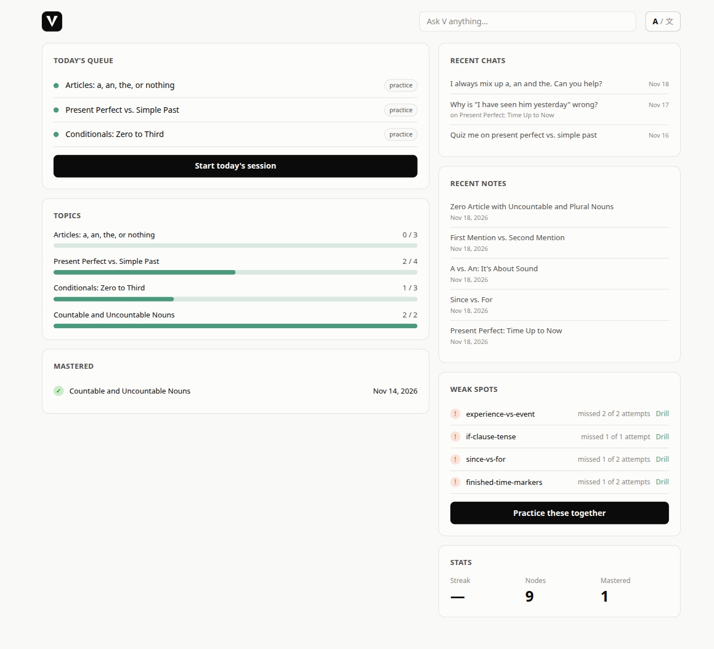

<div align="center">
  
  <h1>Vekr</h1>
</div>

[English](README.md) | [简体中文](README_zh_CN.md)

A personal learning agent. Chat with **V** to collect knowledge into notes, turn notes into topics, practice them with generated questions, and let the agent grade your answers and track your weak spots.



```
Intake → Curriculum Builder → Scheduler ⇄ (Learning Session + Practice & Assessment)
```

## Features

| | Feature | What it does |
| --- | --- | --- |
| 💬 | **Chat with V** | Tool-calling agent with replies streamed live into the page |
| 🌐 | **Web search & fetch** | Searches the web (Tavily) and reads pages, with size limits, timeouts, and safe redirects |
| 🔎 | **Note-aware answers** | V searches, reads, and edits your notes while answering |
| 📌 | **Context-aware chats** | A chat opened from a note knows that note and its topic |
| 💾 | **Save chat as note** | Turn any conversation into a note in your knowledge base |
| 📝 | **Notes & knowledge graph** | Markdown notes linked into one graph, with full-text search |
| 🧭 | **Topic builder** | Ask "teach me X": V previews a topic with outline notes and prerequisites, and saves it only after you confirm |
| 🔁 | **Note → topic** | Turn any existing note into a topic |
| 📈 | **Topic status** | Progresses from not started → learning → practicing → mastered |
| 🧩 | **Practice items** | Generated multiple choice, flashcards, open questions, and code |
| ✅ | **AI grading** | Exact match for multiple choice and flashcards; qualitative LLM feedback for open and code answers |
| 🏷️ | **Mistake tracking** | Each mistake is tagged with a concept and error type (misconception, careless slip, knowledge gap, calculation error) |
| 🎯 | **Weak spots & drills** | Tracks your most-missed concepts and builds drills that mix items across topics |
| 📊 | **Dashboard** | Today's queue, topic progress, mastered topics, recent notes and chats, and stats |
| 🌏 | **English / 简体中文** | Switch with the A/文 button; V replies in the chosen language |
| 🤖 | **Any OpenAI-compatible model** | Local (llama.cpp, Ollama) or hosted |

## Stack

Go (`net/http`), `templ` templates, Postgres (`pgx` + GORM, `golang-migrate`), Hotwire (Turbo + Stimulus via import maps), Tailwind v4, SSE for live updates. The LLM is any OpenAI-compatible `/v1/chat/completions` endpoint, such as llama.cpp or Ollama running locally, or a hosted provider.

## Requirements

- [mise](https://mise.jdx.dev/) installs Go, templ, Tailwind, and golang-migrate at the versions pinned in `mise.toml`
- PostgreSQL
- An OpenAI-compatible LLM endpoint

## Setup

```sh
mise install
cp .envrc.example .envrc
```

Edit `.envrc`, then load it (with [direnv](https://direnv.net/), or `source .envrc`):

| Variable | Default | Purpose |
| --- | --- | --- |
| `DATABASE_USERNAME` / `DATABASE_PASSWORD` / `DATABASE_HOST` | | Postgres connection |
| `APP_ENV` | `development` | Selects the database `vekr_${APP_ENV}` |
| `PORT` | `8000` | HTTP port |
| `AI_BASE_URL` | `http://localhost:11434/v1` | OpenAI-compatible endpoint |
| `AI_MODEL` | `qwen` | Model name |
| `AI_API_KEY` | | API key, if the endpoint needs one |
| `AI_MAX_TOKENS_FIELD` | `max_tokens` | Override for providers that use e.g. `max_completion_tokens` |
| `TAVILY_API_KEY` | | Optional key for the `websearch` tool |

Create the database and run migrations:

```sh
createdb vekr_development
mise run db:migrate
```

Optionally load demo data, a set of English grammar topics with notes, practice attempts, weak spots, and chats:

```sh
mise run db:seed
```

## Running

```sh
mise run dev
```

Open http://localhost:8000. This watches `.templ`, Go, CSS, and locale files and reloads the browser on change. Use `mise run serve` to run once without watching.

## Using Vekr

1. **Chat with V** from the box in the top bar. Ask questions, paste material, or ask V to build a topic on something you want to learn.
2. **Confirm the curriculum** V previews: a topic plus outline notes with prerequisite links.
3. **Read** the topic page (`/topics/{id}`) and its notes. Any note can also be turned into a topic.
4. **Practice**: ask V to generate practice items for a topic, then answer them. V grades each attempt with feedback and logs mistakes per concept.
5. **Review** the dashboard: the queue orders unfinished topics by latest activity, and Weak Spots offers drills that mix items sharing a weak concept across topics.
6. **Save a chat as a note** to keep what you learned in the knowledge graph.

## Commands

```sh
mise run dev                  # generate templates + CSS, run with live reload
mise run serve                # run once, no watching
mise run templates:generate   # templ generate
mise run css:build            # rebuild web/static/css/app.css
mise run db:migrate           # apply migrations
mise run db:seed              # insert demo data (English grammar topics), skipped if topics exist
mise run db:reset             # roll back all migrations, migrate, seed
mise run test                 # go test ./... against vekr_test
mise run js:vendor            # re-fetch vendored Turbo/Stimulus after a version bump
```

`db:migrate` and `db:reset` act on the database selected by `APP_ENV`, e.g. `APP_ENV=test mise run db:reset`.

## Running tests

Tests run against a separate `vekr_test` database:

```sh
createdb vekr_test
APP_ENV=test mise run db:migrate
mise run test
```

## Project layout

```
cmd/server, cmd/seed     entry points
internal/
  handlers/              HTTP handlers
  models/                one file per table
  agent/                 chat loop, distill, curriculum, practice, grading, tools, prompts
  ai/                    OpenAI-compatible client
  live/                  pub/sub for Turbo Stream broadcasts
  i18n/, markdown/, config/
  router.go, middleware.go, app.go
web/templates/           .templ files and generated _templ.go
web/static/              vendored JS, Stimulus controllers, CSS
db/migrations/           plain SQL migrations
locales/                 en.yaml, zh.yaml
```

Generated files (`*_templ.go`, `web/static/css/app.css`) are committed. Regenerate them after editing `.templ` files or CSS.

## Adding a language

All UI strings go through `t(ctx, key)` in templates, and a test checks that every key used in a template exists in the catalog. The current language is stored in the single-row `settings` table and flipped between `en` and `zh` by `POST /locale`.

To add another language: add `locales/<lang>.yaml` with the same keys as `locales/en.yaml`, extend the `locale` CHECK constraint on `settings` with a new migration, and replace the two-way toggle with a picker.

## License

[MIT](LICENSE)
