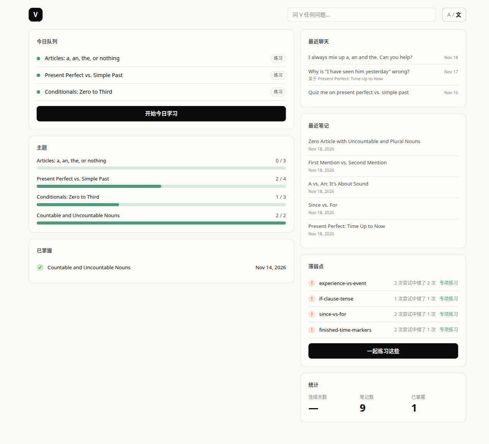

# Vekr [English](README.md) | [简体中文](README_zh_CN.md)

一个个人学习助手。和 **V** 聊天，把知识整理成笔记，再把笔记转为主题；通过自动生成的题目进行练习，由 AI 批改你的答案并追踪你的薄弱点。



```
输入 → 课程构建 → 调度 ⇄ (学习 + 练习与评估)
```

## 功能

**与 V 聊天**
- 可调用工具的智能体，回复实时流式显示在页面上
- 联网搜索（Tavily）和网页抓取，带有大小限制、超时和安全的重定向处理
- 回答时可搜索、阅读和编辑你的笔记
- 理解上下文：从笔记打开的聊天知道当前笔记及其所属主题
- 任何聊天都可以保存为笔记

**笔记与主题**
- Markdown 笔记组成一张知识图谱
- 对所有笔记进行全文搜索
- 根据目标创建主题（"教我 X"）：V 先预览主题、大纲笔记和前置关系，确认后才保存
- 任何已有笔记都可以转为主题
- 主题状态依次为：未开始 → 学习中 → 练习中 → 已掌握

**练习与批改**
- 自动生成练习题：选择题、闪卡、开放题和代码题
- 选择题和闪卡按精确匹配判分；开放题和代码题由大模型给出定性反馈
- 错误会标注所属概念和错误类型（概念误解、粗心失误、知识缺口、计算错误）
- 薄弱点卡片追踪你最常出错的概念，并提供跨主题混合出题的专项练习

**仪表盘**
- 今日队列：按最近活动排列未完成的主题
- 主题进度、已掌握主题、最近的笔记和聊天，以及统计数据

**语言与模型**
- English 和简体中文界面，通过 A/文 按钮切换；V 也会用所选语言回复
- 支持任何兼容 OpenAI 的模型，可本地运行（llama.cpp、Ollama）或使用托管服务

## 技术栈

Go（`net/http`）、`templ` 模板、Postgres（`pgx` + GORM、`golang-migrate`）、Hotwire（Turbo + Stimulus，通过 import map 加载）、Tailwind v4、SSE 实时更新。大模型可以是任何兼容 OpenAI `/v1/chat/completions` 的接口，例如本地运行的 llama.cpp、Ollama，或托管服务。

## 环境要求

- [mise](https://mise.jdx.dev/)：按 `mise.toml` 中固定的版本安装 Go、templ、Tailwind 和 golang-migrate
- PostgreSQL
- 一个兼容 OpenAI 的大模型接口

## 安装

```sh
mise install
cp .envrc.example .envrc
```

编辑 `.envrc`，然后加载它（使用 [direnv](https://direnv.net/) 或 `source .envrc`）：

| 变量 | 默认值 | 用途 |
| --- | --- | --- |
| `DATABASE_USERNAME` / `DATABASE_PASSWORD` / `DATABASE_HOST` | | Postgres 连接信息 |
| `APP_ENV` | `development` | 选择数据库 `vekr_${APP_ENV}` |
| `PORT` | `8000` | HTTP 端口 |
| `AI_BASE_URL` | `http://localhost:11434/v1` | 兼容 OpenAI 的接口地址 |
| `AI_MODEL` | `qwen` | 模型名称 |
| `AI_API_KEY` | | API 密钥（如接口需要） |
| `AI_MAX_TOKENS_FIELD` | `max_tokens` | 部分服务商使用其他字段名，例如 `max_completion_tokens` |
| `TAVILY_API_KEY` | | `websearch` 工具的可选密钥 |

创建数据库并执行迁移：

```sh
createdb vekr_development
createdb vekr_test
mise run db:migrate
APP_ENV=test mise run db:migrate
```

可选：加载演示数据，包含一组英语语法主题、笔记、练习记录、薄弱点和聊天：

```sh
mise run db:seed
```

## 运行

```sh
mise run dev
```

打开 http://localhost:8000。该命令会监听 `.templ`、Go、CSS 和语言文件的变更并自动刷新浏览器。如果只想运行一次、不监听变更，使用 `mise run serve`。

## 使用方法

1. **与 V 聊天**：在顶栏的输入框中提问、粘贴学习材料，或让 V 为你想学的内容创建一个主题。
2. **确认课程**：V 会先预览一个主题及其大纲笔记（带有前置关系），确认后才会保存。
3. **阅读**：打开主题页面（`/topics/{id}`）阅读其中的笔记。任何笔记也都可以转为主题。
4. **练习**：让 V 为某个主题生成练习题，然后作答。V 会给每次作答打分并附上反馈，同时按概念记录错误。
5. **复习**：在仪表盘上，队列按最近活动排列未完成的主题；薄弱点卡片提供专项练习，会跨主题混合涉及同一薄弱概念的题目。
6. **把聊天保存为笔记**，将学到的内容留在知识图谱中。

## 常用命令

```sh
mise run dev                  # 生成模板和 CSS，带热重载运行
mise run serve                # 只运行一次，不监听变更
mise run templates:generate   # templ generate
mise run css:build            # 重新构建 web/static/css/app.css
mise run db:migrate           # 执行迁移
mise run db:seed              # 插入演示数据（英语语法主题），已有主题时跳过
mise run db:reset             # 回滚所有迁移，重新迁移并填充数据
mise run test                 # 针对 vekr_test 运行 go test ./...
mise run js:vendor            # 升级版本后重新拉取 Turbo/Stimulus
```

`db:migrate` 和 `db:reset` 作用于 `APP_ENV` 指定的数据库，例如 `APP_ENV=test mise run db:reset`。

## 项目结构

```
cmd/server, cmd/seed     程序入口
internal/
  handlers/              HTTP 处理器
  models/                每张表一个文件
  agent/                 聊天循环、提炼、课程、练习、批改、工具、提示词
  ai/                    兼容 OpenAI 的客户端
  live/                  Turbo Stream 广播的发布/订阅
  i18n/, markdown/, config/
  router.go, middleware.go, app.go
web/templates/           .templ 文件及生成的 _templ.go
web/static/              内置 JS、Stimulus 控制器、CSS
db/migrations/           纯 SQL 迁移文件
locales/                 en.yaml, zh.yaml
```

生成的文件（`*_templ.go`、`web/static/css/app.css`）会提交到仓库。修改 `.templ` 文件或 CSS 后需要重新生成。

## 添加新语言

所有界面文字都通过模板中的 `t(ctx, key)` 获取，并有测试检查模板用到的每个 key 都存在于语言文件中。当前语言保存在单行的 `settings` 表中，通过 `POST /locale` 在 `en` 和 `zh` 之间切换。

添加其他语言的步骤：新增 `locales/<lang>.yaml`，包含与 `locales/en.yaml` 相同的 key；通过新迁移扩展 `settings` 表上 `locale` 的 CHECK 约束；把双语切换按钮改为语言选择器。

## 许可证

[MIT](LICENSE)
